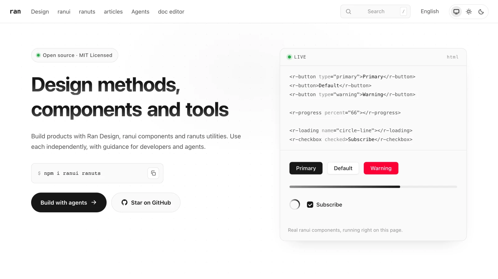

<p align="center">
  <picture>
    <source media="(prefers-color-scheme: dark)" srcset="./packages/docs/public/icon-dark.png">
    
  </picture>
</p>

<h1 align="center">ran</h1>
<p align="center">웹 제품을 만들기 위한 디자인 방법, 컴포넌트, 도구. 개발자와 코딩 에이전트 모두를 위해.</p>

<p align="center">
  <a href="https://www.npmjs.com/package/ranui"></a>
  <a href="https://www.npmjs.com/package/ranuts"></a>
  <a href="https://github.com/chaxus/ran/actions/workflows/ci.yml"></a>
  <a href="./LICENSE"></a>
</p>

<p align="center"><a href="https://ran.chaxus.com/ko/">문서</a> · <a href="https://ran.chaxus.com/ko/ranui/">컴포넌트</a> · <a href="https://ran.chaxus.com/ko/agents/">에이전트</a></p>
<p align="center"><a href="./README.md">English</a> · <a href="./README.zh-CN.md">中文</a> · <a href="./README.ja.md">日本語</a> · <a href="./README.es.md">Español</a> · <a href="./README.pt.md">Português</a> · <b>한국어</b> · <a href="./README.de.md">Deutsch</a> · <a href="./README.fa.md">فارسی</a></p>

ran은 각각 따로 쓸 수 있는 세 부분으로 이루어져 있습니다. **ranui**는 네이티브 커스텀 엘리먼트로 만든 UI 컴포넌트, **ranuts**는 타입이 있는 TypeScript 유틸리티, **Ran Design**은 사람과 코딩 에이전트가 어떤 기술 스택에서든 적용할 수 있는 레이아웃·인터랙션·검수 방법입니다.

- **어떤 프레임워크에서도, 프레임워크 없이도 동작합니다.** 모든 컴포넌트는 `<r-*>` 태그라서 React, Vue, Svelte, 일반 HTML 파일에서 똑같이 씁니다. 어댑터나 프레임워크 런타임이 필요 없고 script 태그 하나면 충분합니다.
- **AI 채팅 화면을 위한 구성 요소.** 스트리밍 출력을 따라가는 대화 뷰, 작성 중인 텍스트도 렌더링하는 Markdown, 추론과 도구 호출 행, 첨부 파일, 음성 입력. 스트리밍 응답 해석은 `ranuts/stream`이 맡습니다.
- **테마, 서버 렌더링, 타입 포함.** 디자인 토큰 기반의 라이트·다크 테마, SSR 도구, TypeScript 타입 선언이 패키지에 들어 있습니다.
- **쓰는 것만 설치합니다.** 패키지마다, 컴포넌트마다 독립된 진입점이 있습니다.

<p align="center">
  <picture>
    <source media="(prefers-color-scheme: dark)" srcset="./.github/assets/readme-home-dark.webp">
    
  </picture>
</p>

## 패키지

| 패키지                                   | 용도                                                                                                              |
| ---------------------------------------- | ----------------------------------------------------------------------------------------------------------------- |
| [ranui](./packages/ranui/README.ko.md)   | 커스텀 엘리먼트로 만드는 폼, 대화상자, 표, Markdown, 미디어 플레이어, AI 채팅 화면. 테마와 서버 렌더링 도구 포함. |
| [ranuts](./packages/ranuts/README.ko.md) | 문자열, 색상, 시간, 파일, 저장소, DOM을 위한 헬퍼와 SSE 파싱, 스트리밍 응답 상태 관리.                            |
| [Ran Design](./design/README.md)         | 구성, 인터랙션, 모션, 근거 기반 검수를 위한 방법. 에이전트 플러그인으로 배포되며 ranui 없이도 쓸 수 있습니다.     |

ranui의 빌더와 반응성 계층은 [@alixex/ranview](./packages/ranview/README.md)로 따로 배포됩니다.

## 빠른 시작

빌드 없이 쓰려면 CDN에서 컴포넌트를 불러오고 태그를 작성합니다.

```html
<script src="https://cdn.jsdelivr.net/npm/ranui/dist/iife/button.iife.js" defer></script>
<r-button type="primary">저장</r-button>
```

번들러를 쓴다면 패키지를 설치하고 사용할 컴포넌트를 가져옵니다.

```sh
npm install ranui
```

```js
import 'ranui/button';
import 'ranui/style';
```

ranui는 알파 단계라 새 버전에 호환되지 않는 변경이 들어갈 수 있으니 프로덕션에서는 정확한 버전을 고정하세요. 각 요소의 라이브 예제, 이벤트, 스타일은 [컴포넌트 문서](https://ran.chaxus.com/ko/ranui/)에 있습니다.

## 코딩 에이전트와 함께 쓰기

**ran** 플러그인은 Claude Code와 Codex에 design, ranui, ranuts 세 가지 스킬을 추가합니다. MCP 서버나 계정이 필요 없습니다.

```sh
claude plugin marketplace add chaxus/ran && claude plugin install ran@ran
```

```sh
codex plugin marketplace add chaxus/ran && codex plugin add ran@ran
```

새 세션에서 Claude Code는 `/ran:design`, `/ran:ranui`, `/ran:ranuts`를, Codex는 `$design`, `$ranui`, `$ranuts`를 사용합니다. 로컬 체크아웃에서 설치하는 방법은 [에이전트 가이드](https://ran.chaxus.com/ko/agents/)를, 스킬 본문은 [plugins/ran](./plugins/ran/)을 참고하세요.

## 기여하기

Node 24 이상과 `package.json`에 고정된 pnpm 버전을 사용합니다.

```sh
pnpm install --frozen-lockfile
pnpm build
pnpm test
pnpm -F docs dev
```

기여하기 전에 [AGENTS.md](./AGENTS.md)를, 패키지를 배포할 때는 [배포 가이드](./docs/RELEASING.md)를 읽어 주세요.

## 라이선스

[MIT](./LICENSE)
