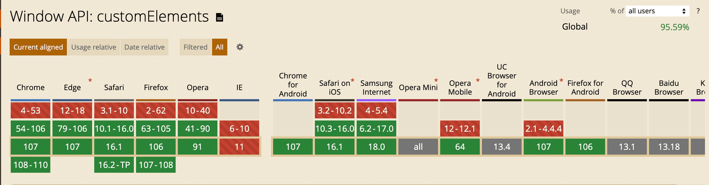

# ranui

**ネイティブのカスタム要素**で作られた UI ライブラリです。どのコンポーネントも `<r-*>` タグなので、
React でも Vue でも Svelte でも Solid でも Astro でも、素の HTML ファイルでも同じように動きます。
アダプターは要らず、フレームワークのバージョンを合わせる必要もありません。TypeScript の型定義、
デザイントークンによるライト／ダークテーマ、Shadow DOM によるカプセル化、サーバーレンダリングを
最初から備えています。

<PackageFacts package="ranui" />

- ranui は **alpha** です。バージョンには破壊的変更が入ります。バージョンを正確に固定し、
  アップグレード前に[更新履歴](/ja/ranui/changelog)を読んでください。

## インストール

```bash
npm install ranui
```

```html
<!-- CDN からでも。ビルド工程は不要 -->
<script src="https://unpkg.com/ranui/dist/index.iife.js"></script>
```

## 使い方

import すると要素が登録されます。あとはタグを書くだけです。

```js
import 'ranui'; // すべてのコンポーネント
import 'ranui/button'; // 一つだけでも
```

```html
<r-button type="primary">プロジェクトをデプロイ</r-button>
```

タグはどのフレームワークでも同じです。違うのは値の渡し方とイベントの結び付け方だけで、それは
[コーディング規約](/ja/ranui/coding-guides/#framework-integration)で詳しく扱っています。

::: code-group

```html [HTML]
<script src="https://unpkg.com/ranui/dist/index.iife.js"></script>

<body>
  <r-button>Button</r-button>
</body>
```

```jsx [React]
import 'ranui';

export const App = () => <r-button type="primary">Deploy</r-button>;
// 複雑な値とイベントリスナーは ref 経由で渡します — コーディング規約を参照。
```

```vue [Vue]
<template>
  <r-button type="primary" @click="deploy">Deploy</r-button>
</template>

<!-- ビルド設定の compilerOptions.isCustomElement に `r-` を追加してください。 -->
```

```js [Plain JS]
import 'ranui';

const button = document.createElement('r-button');
button.textContent = 'Deploy';
document.body.appendChild(button);
```

:::

## エントリーポイント

各エントリーは名前どおりのものだけを登録します。テーマだけが欲しいページがコンポーネント
ライブラリの分を負担することはありません。

| import                                                | 中身                                                    |
| ----------------------------------------------------- | ------------------------------------------------------- |
| `ranui`                                               | すべてのコンポーネント                                  |
| `ranui/<component>`                                   | コンポーネント一つ：`ranui/button`、`ranui/select`、…   |
| [`ranui/theme`](/ja/ranui/theme/)                 | ライト／ダークテーマとトークンの上書き。要素は含まない  |
| [`ranui/i18n`](/ja/ranui/i18n/)                   | 翻訳エンジン。要素は含まない                            |
| `ranui/fonts`                                         | セルフホストの Geist Sans + Geist Mono                  |
| `ranui/style`                                         | スタイルシート。自動で読み込まれない環境向け            |
| [`ranui/builder`](/ja/ranui/builder/)             | 細粒度リアクティビティつきの流暢な DOM ビルダー         |
| [`ranui/ssr`](/ja/ranui/ssr/), `ranui/ssr-stream` | サーバーレンダリング                                    |
| `ranui/testing`                                       | テストから閉じた shadow root に手を入れるためのヘルパー |
| `ranui/typings`                                       | アンビエントな JSX / TS の要素型                        |

## コンポーネント

41 要素。属性、プロパティ、イベント、スロット、`::part()` 名まで含めた全体像は
[要素 API リファレンス](/ja/ranui/api)にあります。

**共通**: [Button](/ja/ranui/button/) · [Icon](/ja/ranui/icon/) ·
[Loading](/ja/ranui/loading/)

**データ入力**: [Input](/ja/ranui/input/) · [CheckBox](/ja/ranui/checkbox/) ·
[Select](/ja/ranui/select/) · [ColorPicker](/ja/ranui/colorpicker/) ·
[Attachments](/ja/ranui/attachments/) · [VoiceButton](/ja/ranui/voice-button/) ·
[Forms](/ja/ranui/form/)

**データ表示**: [Card](/ja/ranui/card/) · [Section](/ja/ranui/section/) ·
[Tabs](/ja/ranui/tab/) · [Image](/ja/ranui/image/) · [Progress](/ja/ranui/progress/) ·
[Radar](/ja/ranui/radar/) · [Player](/ja/ranui/player/) · [Preview](/ja/ranui/preview/) ·
[Glass](/ja/ranui/glass/) · [Scratch](/ja/ranui/scratch/) ·
[StateDot](/ja/ranui/state-dot/) · [DisclosureRow](/ja/ranui/disclosure-row/)

**コンテンツ描画**: [Markdown](/ja/ranui/markdown/) · [Math](/ja/ranui/math/) ·
[Mermaid](/ja/ranui/mermaid/)

**AI とチャット**: [Conversation](/ja/ranui/conversation/) ·
[Reasoning](/ja/ranui/reasoning/) · [ToolCard](/ja/ranui/tool-card/) ·
[TokenMeter](/ja/ranui/token-meter/)

**オーバーレイとフィードバック**: [Modal](/ja/ranui/modal/) · [Popover](/ja/ranui/popover/) ·
[Dropdown](/ja/ranui/dropdown/) · [Message](/ja/ranui/message/) ·
[Skeleton](/ja/ranui/skeleton/)

**ナビゲーション**: [Router](/ja/ranui/router/) · [Route](/ja/ranui/route/) ·
[Link](/ja/ranui/link/)

**基盤**: [テーマ](/ja/ranui/theme/) · [ThemeSwitch](/ja/ranui/theme-switch/) ·
[i18n](/ja/ranui/i18n/)

5 つの要素には専用ページがありません。ほかの要素の内側でしか存在しないからです：`<r-option>`
（Select）、`<r-tabs>`（Tabs）、`<r-img>`（Image）、`<r-dropdown-item>`（Dropdown）、
`<r-content>`（Popover）。ほかと同じく API リファレンスには載っています。

### ライブ

<div style="display:flex;flex-wrap:wrap;align-items:center;gap:12px;margin-bottom:12px">
  <r-button type="primary">Primary</r-button>
  <r-button type="warning">Warning</r-button>
  <r-button type="text">Text</r-button>
  <r-button>Default</r-button>
  <r-icon name="lock" size="28"></r-icon>
  <r-icon name="user" size="28"></r-icon>
  <r-icon name="loading" size="28" color="#1E90FF" spin></r-icon>
</div>

<div style="width:100%;margin-bottom:12px">
  <r-progress percent="0.7" type="drag"></r-progress>
</div>

<r-markdown copy content="**Streaming** Markdown with `code`, tables, mermaid and math."></r-markdown>

## スタイリング

コンポーネントは**閉じた** shadow root に描画されます。ページ側の CSS は中へ漏れず、セレクターも
中へ届きません。入口は 4 つあり、以下は推奨順です。

**1. デザイントークン（CSS カスタムプロパティ）**：境界を越えて継承されるので、`:root` でも、
外側のコンテナでも、要素そのものでも指定できます。

```html
<r-progress
  percent="0.7"
  type="drag"
  style="--ran-progress-track-background: linear-gradient(to right, #f00, #ff0, #0f0, #0ff, #00f)"
></r-progress>
```

<div style="width:100%;margin:12px 0">
  <r-progress percent="0.7" type="drag" style="--ran-progress-track-background:linear-gradient(to right, #ff0000, #ffff00, #00ff00, #00ffff, #0000ff, #ff00ff, #ff0000);"></r-progress>
</div>

**2. `::part()`**：トークンでは届かない構造的な調整に ·
**3. `sheet` 属性**：shadow root へ CSS を注入する ·
**4. スロットに渡した内容**：あなたのドキュメントに留まり、ページの CSS がそのまま効きます。

トークンの名前は[デザインシステム](/ja/ranui/design-system/)に、どれを選ぶかの基準は
[デザインガイドライン](/ja/ranui/design-guides/)に、仕組みは
[コーディング規約](/ja/ranui/coding-guides/#styling-across-the-shadow-boundary)にあります。

## イベント

コンポーネントは `CustomEvent` を派発し、中身は `detail` に入ります。リスナーは要素に結び付けて
ください。イベントがバブリングするかはコンポーネントごとの判断で、API リファレンスがすべてについて
明記しています。

```html
<r-select id="env"></r-select>

<script>
  document.getElementById('env').addEventListener('change', (event) => {
    console.log(event.detail.value);
  });
</script>
```

これらは普通の DOM 要素なので `onchange="…"` 属性形式も `el.onchange = …` プロパティ形式も動きます。
ただしハンドラーは一つしか持てず、キャプチャフェーズも使えないので、まずは `addEventListener` を
選んでください。

## 次に読むもの

| やりたいこと                                 | 読むページ                                           |
| -------------------------------------------- | ---------------------------------------------------- |
| 要素の正確な API を調べる                    | [要素 API](/ja/ranui/api)                        |
| どのトークンを使うべきか、その理由を知る     | [デザインシステム](/ja/ranui/design-system/)     |
| 一つの体系に見える画面を作る                 | [デザインガイドライン](/ja/ranui/design-guides/) |
| ranui をアプリへ正しく組み込む               | [コーディング規約](/ja/ranui/coding-guides/)     |
| ライト／ダークを足す、全体を作り替える       | [テーマ](/ja/ranui/theme/)                       |
| インターフェースを翻訳する                   | [i18n](/ja/ranui/i18n/)                          |
| サーバー側で描画する                         | [サーバーレンダリング](/ja/ranui/ssr/)           |
| フレームワークなしでリアクティブな画面を作る | [ビルダー](/ja/ranui/builder/)                   |
| アップグレード前に変更点を確認する           | [更新履歴](/ja/ranui/changelog)                  |

## ブラウザ対応

Custom Elements v1、Shadow DOM v1、CSS カスタムプロパティの上に作られているので、現代のブラウザ
すべてで動きます。**Internet Explorer は対象外です。**



## コントリビューター

<a href="https://github.com/chaxus/ran/graphs/contributors">
  
</a>

## さらに読む

このライブラリが立脚する標準：[W3C](https://www.w3.org/) ·
[ECMA](https://www.ecma-international.org/) · [RFC](https://www.rfc-editor.org/) ·
[Can I use](https://caniuse.com/)

開いておく価値のあるデザインの参考資料：[Checklist Design](https://www.checklist.design/) ·
[Laws of UX](https://lawsofux.com/) · [Geist](https://vercel.com/geist) ·
[Ant Design](https://ant.design/index-cn) · [Element UI](https://element.eleme.cn/#/zh-CN) ·
[Animista](https://animista.net/) · [WebGradients](https://webgradients.com/)
